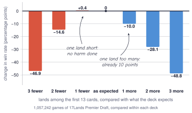
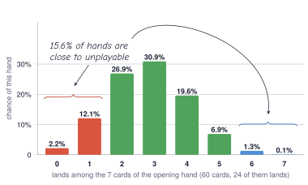
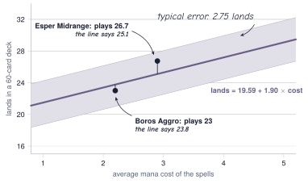
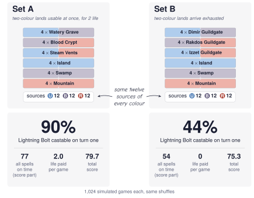

<!-- ## Three line summary

<!-- - In a wizard's duel (a game of *Magic: The Gathering*) you can only cast your spells if you draw the right *lands*, in the right colours, at the right time. Which lands to put in your spellbook is a probability problem.

<!-- - The classical answers count cards. The hypergeometric distribution tells you how likely you are to draw enough lands of one colour. Frank Karsten's tables, which he computes by simulating draws because the formula cannot handle mulligans, turn that into “play $14$ sources for this spell”, and a regression on $95{,}143$ tournament decks tells you how many lands to play in total.

<!-- - Counting stops working when lands interact with each other, with your spells and with your life total. That is where Part 2 begins.

<!-- ## Why should I care?

<!-- If you play Magic, because few things lose more games than your own lands, and the difference between a good and a bad set of lands is invisible until it is too late. If you don't, because it is a pleasant excuse to meet the hypergeometric distribution, conditional probability, Hall's marriage theorem and a linear regression, all of them doing honest work. No knowledge of the game is assumed. Everything we need is explained in the next section. -->

## Introduction

It's been two years since my last post. Finishing my PhD and starting my postdoc has kept me busier than expected. However, I feel it is time to fire the printing presses back up. After all, there is a pleasure in writing one's thoughts freely, and what else is one to do on a rainy Lancastrian night.

Our topic today is different to those we have touched on before. We will temporarily abandon pure mathematics (don't worry, we'll be back) for a much more practical application. Namely, we will assume that we are renowned wizards (as I said, it's practical), duelling for magical supremacy against rival spell-casters. Now, as everyone knows, wizards are very particular about their duels, which follow well defined rules. If you already know how to play Magic, feel free to skip to @sec-does-it-matter.

1. Each wizard prepares in advance a spellbook (also called a *deck*) of at least $60$ spells (the wizarding committee is very strict about this). Spells may damage the opponent, draw more spells, summon magical creatures, or do a whole host of other things that help a wizard gain the upper hand.

2. Each wizard begins the duel holding $7$ spells from their spellbook, selected at random by the onlookers.

3. A coin is flipped to decide which wizard goes first (yes, even wizards haven't found a better way to do this).

4. The first wizard casts the spells they wish and then passes the turn. Their opponent draws one more spell from their book (and so holds $8$), casts their own spells, and passes back.

5. The wizards continue in this fashion, drawing one spell and casting what they can each turn, until one of them is defeated. The other is declared the victor.

### Mana

As anyone who has attended wizarding school knows, casting spells is a tricky business. To cast a spell a wizard needs enough raw magical power, called *mana*. There are five types of mana, one for each school of magic: light , water , dark , fire  and earth . The cost of a spell is printed in its corner. Here are three from the spellbook of Archibaldus the Grey, believed by many to be the most powerful wizard in the land. Text has been simplified to be easier to read by those not schooled in the wizardly arts.

::: {#fig-spells}



Three spells from the book of Archibaldus.  The cost is in the top corner.
:::

So Lightning Bolt needs one fire mana, the Electromancer needs one water *and* one fire mana, and the Charm needs water, dark and fire all at once. Some spells also ask for mana of any type, written as a number: a cost of  means two water mana and one more of any type.

A wizard starts the duel with no mana at all. To obtain their mana they must play a special kind of spell called a *land*. There are three rules.

- A wizard may play at most one land each turn.

- A land stays in play for the rest of the duel.

- Each turn, each land may be used once to produce one mana of its type. A Mountain gives , an Island , a Swamp , a Forest  and a Plains .

::: {#fig-basics}



The five basic lands. Each makes mana of one colour.
:::

So a wizard has one mana on the first turn, two on the second, three on the third, provided they keep drawing lands. Lands and spells sit in the same spellbook and are drawn from the same pile. Drawing the right lands at the right time is tricky business and is what the rest of the post is about.

### Archibaldus wins a practice bout

Let us watch a few turns of Archibaldus' practive bout this morning. To keep things simple there is no opponent, and we only show the cards that matter. Archibaldus begins with no lands or spells cast and only cards in his hand press *Next* to step through his first three turns.

::: {#fig-duel-lucky}



<!-- I would remove the repeated artist names we have already mentioned them before. ALso I feel like caption right now is easy to confuse with art details and perhaps a tad too light -->

Archibaldus wins a practice bout. Press Next to step through his first three turns.
:::

Archibaldus has done everything right. His mana grew every turn and he cast a stronger spell each time. In a real duel his opponent would be in serious trouble. A critical eye, however, might say he was a little lucky. Here is the same hand with different draws.

::: {#fig-duel-unlucky}



The same opening hand with different draws.
:::

This is known in the wizarding community as being *mana-locked* (the more common term is not fit for print). Related problems are drawing too few lands of any kind, and drawing exclusively lands, leaving the wizard with nothing to cost. All three are frustrating, and all three happen to the most powerful and esteemed wizards. Imagine the disgrace if Archibaldus lost to a novice because he drew the wrong lands and stood there unable to cast a thing. This is a problem, and a very important one. Archibaldus has entrusted us with solving it, or at least with making it as rare as we can.

To address the problem we must first look at the solutions the most powerful wizards already use.

### Better lands

The five lands above are called *basic lands*. There are also more versatile lands, known as *non-basic lands*, that can produce more than one type of mana.

::: {#fig-nonbasic}



Four non-basic lands and what each one costs you.
:::

Had Archibaldus drawn a land that produces water or dark mana in place of his first Swamp, he would have cast the rest of his hand without trouble. So why not play only these? Because each comes with a price. Some enter play exhausted, so the wizard waits a turn before using them. Some cost life (a wizard begins with $20$ and loses at zero). And they are no guarantee: had he drawn a land that produces dark or fire mana, he would have been as stuck as before with no blue mana to cast his spells. Non-basic lands help but they are not a panacea.

### Going mono-colour
Some wizards specialise in a single school of magic and play, say, only earth spells. They are never short of the right colour. Unfortunately, they also give up some of the most powerful spells, which tend to be the ones that combine schools.

::: {#fig-one-vs-two}



Two creatures with the same total cost.
:::

Moreover, even a mono-colour wizard must decide *how many* lands to play. Too few, and they cannot cast their spells. Too many, and there are no spells left to cast.

<!-- At some point there is a transition form wizar terms to mtg terms (spell -> card, book-> deck, etc this should be cleared up, makes sense thouhg to avoid confusing MTG players as a land does not count as speel perhaps this changes how land should be introduced?)-->
It is worth asking how much is at stake. Happily, wizards keep records. The site 17Lands publishes the full history of millions of real games, including how many lands each player saw [@seventeenlandsdata]. We took $1{,}057{,}242$ of them (duels of the $40$-spell format called “Limited”) and asked a simple question: among the first $13$ cards a player saw, how many were lands, compared with what their deck would give on average? And how often did they win?

{#fig-land-price fig-align="center" width="80%"}
<!-- Text is small and hard to see I would imporve the UI on this to not use as much text for example y axis could just be chage in winrate in % change what that decks epxects to the average of the deck -->

The comparison is made within each deck, so that a strong deck does not distort it. Two points are important. The stakes are large: a couple of lands is the difference between a favourite and an underdog. And the curve is lopsided: in these duels, too many lands is worse than too few. One land fewer than expected costs nothing. One land more costs $10$ points of win rate. We will meet this lopsidedness again in Part 2 (yes a follow up is planned), where it turns out to matter a great deal.

As we have seen there are two main problems: choosing the type of lands (basic, non-basic and which within each group) and how many of them to play. We begin by stydying the problem with the most idealized approach. We jot down the mathematical details for the specialist, but keep the discussion understandable even without following the equations

## Exact probabilistic calculation

Suppose a spellbook has $N$ cards of which $K$ are “good” (for instance, lands that produce fire mana). We look at $n$ cards from a well shuffled book. How many good ones do we see? This is determined by the hypergeometric distribution
<!-- Maybe make this a dropdown? Articles should be such that people with math up to high schoollevel can follow with mathematical details providing further depth with those withmore background. Here it is enough to state what this achieves. Namely, in a deck with basics, I can calculate probability of being able to play my spells on a given turn but does not easily account for non-basics, card draw, mana ramp, exampel iamges of such cards, e.g. brainstorm and llanowar elves, etc. Should be such that if I hide all ettttails I still get the message -->

::: {#def-hypergeometric}

Let $X$ be the number of good cards among $n$ cards drawn without replacement from $N$ cards of which $K$ are good. Then $X$ follows the *hypergeometric distribution*,

$$
\mathbb{P}(X=k)=\frac{\binom{K}{k}\binom{N-K}{n-k}}{\binom{N}{n}}, \qquad \max(0,n-N+K)\le k\le \min(n,K).
$$ {#eq-hypergeometric}

:::

The formula is a count. There are $\binom{N}{n}$ equally likely sets of $n$ cards. To have exactly $k$ good ones we choose them in $\binom{K}{k}$ ways and choose the other $n-k$ cards from the $N-K$ bad ones. The case we need most is “at least one”, which is easiest through its complement:

$$
\mathbb{P}(X\ge 1)=1-\frac{\binom{N-K}{n}}{\binom{N}{n}}.
$$ {#eq-at-least-one}

::: {#exm-opening name="The opening hand"}

A typical spellbook has $N=60$ cards and $K=24$ lands. The number of lands in an opening hand of $n=7$ is distributed as follows.

| Lands in hand | 0 | 1 | 2 | 3 | 4 | 5 | 6 | 7 |
|:--|:-:|:-:|:-:|:-:|:-:|:-:|:-:|:-:|
| Probability (%) | 2.2 | 12.1 | 26.9 | 30.9 | 19.6 | 6.9 | 1.3 | 0.1 |

A hand with $0$, $1$, $6$ or $7$ lands is close to unplayable, and that happens $15.6\%$ of the time: roughly one duel in six starts badly before a single card is played.

:::

{#fig-opening-hand fig-align="center" width="75%"}

::: {#exm-bolt name="Lightning Bolt on turn one"}

Archibaldus goes first and wants to cast Lightning Bolt at once. He needs a fire land among his $7$ cards. By (@eq-at-least-one), if his 60 card deck contains $K$ fire lands,

| Fire lands $K$ | 8 | 10 | 12 | 14 | 16 | 18 | 20 |
|:--|:-:|:-:|:-:|:-:|:-:|:-:|:-:|
| % success | 65.4 | 74.1 | 80.9 | 86.1 | 90.1 | 93.0 | 95.2 |

To be $90\%$ sure he needs $16$ of his $24$ lands to produce fire. If we play only basics, that leaves $8$ for water and dark, with which the Electromancer and the Charm are in serious danger. Thus, we must resort to non-basic lands but this complicates matters a great deal.

:::

### Paying a cost is a matching problem

The hard questions begin when a spell needs two colours, or when a land can produce two. To state them properly we need to say what it means to be *able to pay*.

A wizard has $m$ lands $\ell_1,\dots,\ell_m$ in play, and land $\ell_j$ can produce any one colour in a set $A_j\subseteq\{W,U,B,R,G\}$. A spell costs $p_c$ mana of type colour $c$ and $g$ mana of “any type”. Write $\abs{p}:=\sum_c p_c$. Paying the cost means assigning a different land to each symbol, such that the land assigned to a symbol of colour $c$ has $c\in A_j$. This is a matching problem for a [bipartite graph](https://en.wikipedia.org/wiki/Bipartite_graph).

<!--<!-- A figure here would be quite useful, could show lands with mana they can produced matched to spell colors. NOt usre this covers things like filter lands though where you haev to pay mana for the land itself, could be worth a note. This disuccsion should also be put in a detail dropdown the relveant part bein summarized at a higher level with brief and claear language-->

::: {#prp-hall name="When can a wizard pay?"}

The cost can be paid if and only if $m\ge \abs{p}+g$ and, for every set of colours $C\subseteq\{W,U,B,R,G\}$,
<!--<!-- I feel like this can be simplified so C={W,U,B,R,G} this would read cost can be paid if and only if I have enough lands of the colors-->
$$
\#\{j : A_j\cap C\neq\emptyset\}\;\ge\;\sum_{c\in C}p_c .
$$ {#eq-hall}

In words: for every group of colours, the lands that produce at least one colour of the group are at least as many as the symbols of the group.

:::

::: {.proof}

Both conditions are clearly necessary. For sufficiency, [Hall's marriage theorem](https://en.wikipedia.org/wiki/Hall's_marriage_theorem)

<!--Don't see the equivalence statemnt of H tehreom is for selecting disting elements of the sets of a familiy (why do we want to sleect distinct elements, coooors may be repeated, maybe sets is sets of lands? And I want to sleect such that no repertiont yes. But i can always choose lands with repertinios where does condition of matching mana come in-->

says that the coloured symbols can all be matched to distinct lands if and only if every set $S$ of symbols has at least $|S|$ lands that can pay for one of its members. The lands that can pay for a member of $S$ depend only on the set $C$ of colours appearing in $S$, and the largest $S$ with colours in $C$ consists of all the symbols of those colours. So Hall's condition for all $S$ is equivalent to (@eq-hall) for all $C$. Once the coloured symbols are matched, the generic mana can be paid by any $g$ of the remaining $m-p$ lands, which is possible exactly when $m\ge p+g$.

:::

For the Goblin Electromancer, with cost , condition (@eq-hall) reads: at least one land that makes water, at least one that makes fire, and at least *two* lands that make water or fire. The third condition is the one people forget. A single land that makes both colours satisfies the first two and still cannot pay for the Electromancer on its own.

There are $2^5-1=31$ such inequalities, and each coloured land in the book belongs to one of the $31$ possible types $A_j$. The number of lands of each type among the cards seen follows a multivariate version of (@eq-hypergeometric), so in principle the probability of being able to pay is a finite sum. In practice nobody writes it down.
<!--<!-- Can you estimate the number of terms in the sum?-->
The sum runs over all ways of splitting the cards seen among the land types, and it still ignores which land was played on which turn, lands that enter exhausted, lands that replace themselves with other lands, and every spell that draws a card. This is the point at which scholar-wizards reach for a computer.

## Approximate probabilistic calculation

A more refined solution is for the wizard to attempt to estimate the probability of drawing lands in the right amount and type to be able to cast their spells. This is the path of the scholar-wizards, perhaps the greatest of whom is Frank Karsten, a member of the wizarding Hall of Fame who also holds a PhD in probability and game theory. His two articles [@karsten2018sources; @karsten2022lands] are what most serious wizards consult.

### How many lands of each type?
Karsten first [@karsten2018sources] is to separate two ways of failing. If Archibaldus cannot cast a three-mana spell on turn three because he only has two lands, that is the fault of the *number* of lands. If he has three lands of the wrong colours, that is the fault of the *type* of lands. To judge the type alone, Karsten conditions on having enough lands. For a spell that costs $M$ mana in total, of which $k$ symbols are of one colour, he asks for
$$
\mathbb{P}\bigl(\text{at least } k \text{ sources of the colour by turn } M \;\big|\; \text{at least } M \text{ lands by turn } M\bigr),
$$ {#eq-karsten}
<!--<!-- Hmm maybe some math is useful even in main text but condiitonaly notation should be made clear how to read. Also blank lines between block equations and text makes largeee gap so remove-->

for the wizard who goes first. To see what the conditioning does, return to @exm-bolt with $K=14$ fire lands and 24 lands of all types in the deck and $M=1$. The event “a fire land in hand” is contained in the event “a land in hand”, so

$$
\mathbb{P}(\text{fire land}\mid\text{land})=\frac{\mathbb{P}(\text{fire land})}{\mathbb{P}(\text{land})}=\frac{0.861}{0.978}=0.880 .
$$

Karsten then lets the wizard take a *mulligan*, that is, return an unplayable hand and draw a new one with one card fewer. His rule is to return any seven-card hand with $0$, $1$, $6$ or $7$ lands, which are the bad hands of @exm-opening. Mulligans and conditioning cannot be folded into (@eq-hypergeometric) by hand,
<!--<!-- COuld be by summing many condiitonals thogh veyr annoying-->
so he estimates (@eq-karsten) by simulating a great many opening hands and draws for a $60$-card book with $24$ lands. Finally, he fixes a target percentage for being able to cast ones spells: $90\%$ for one-mana spells, rising by one point per mana to $95\%$ for six-mana spells. The smallest number of sources that reaches the level is his recommendation. Here is a slice of the result, where $C$ is a symbol of the colour in question and a number is generic mana.

| Cost | Cast on turn | Sources needed (of 24 lands) |
|:--|:--|:-:|
| $C$ | 1 | 14 |
| $1C$ | 2 | 13 |
| $2C$ | 3 | 11 |
| $CC$ | 2 | 20 |
| $1CC$ | 3 | 18 |
| $CCC$ | 3 | 23 |

So Lightning Bolt requires $14$ fire sources, and a spell costing two water mana requires $20$ water sources. A wizard playing both needs lands that make both colours, since $14+20>24$. The table is simple, fast and has rightly become the standard.

It is also, by design, a table about **one spell** and **one colour** at a time, in a book where **lands are the only source of mana**. Everything else needs a rule of thumb. This includes adapting the table for spells with multiple colours, lands that enters exhausted, cost life, or fetch other lands, creatures that produce mana, spells that draw cards and allow you to manipulate youur deck, and tthe list continues. Furthermore how should one choose the optimal percentage for casting a spell? Too high imposes excessive constraints and too low spells that often cannot be played. The $90\%$ rule is again only a rule of thumb.

## How many lands?

The table assumes $24$ lands. But is that how many we should play? To answer this question Karsten turns to data [@karsten2022lands]. He collected $95{,}143$ tournament decks of $60$ cards that had won more matches than they lost, and fitted a linear regression of the number of lands on three features of the deck:

$$
\text{lands}\;\approx\;19.59\;+\;1.90\,\bar m\;-\;0.28\,d\;+\;0.27\,c ,
$$ {#eq-regression}

where $\bar m$ is the average mana cost of the spells, $d$ is the number of cheap spells that draw cards or produce mana, and $c$ is $1$ if the deck uses a *companion* (an extra spell available from the start) and $0$ otherwise. A book whose spells cost $3$ on average gets $19.59+1.90\cdot 3\approx 25.3$ lands, and loses one land for every three or four cheap card-drawing spells.

{#fig-regression fig-align="center" width="75%"}

This is a description of what successful wizards do, and a very useful starting point. Its author reports the fit plainly: the model explains about $40\%$ of the variation ($R^2=0.395$), with a typical error of $2.75$ lands. However, recall from @sec-does-it-matter what two or even three lands can cost.

## Is this enough?

Let us collect what the scholar-wizards have given Archibaldus. He knows how many lands to play, to within two or three. He knows how many sources each of his spells would like (though the rules of thumb make it unclear). What he does not have is the thing he asked for, namely *a list of lands*. There are seveal gaps:

- **Lands are not interchangeable sources.** Two sets of lands can have exactly the same number of sources of every colour and play very differently, because one enters exhausted, another costs life, and a third only works if a particular land is already in play.

- **Choices.** A land that makes water *or* dark mana must choose each turn. A land that fetches another must choose once and for all.  The count treats it as both at once.

- **The spells talk back.** A spell that draws two cards finds lands. A creature that makes mana is a land that can die. Whether these are worth half a source or a third depends on when they are cast, which depends on the lands.

- **One spell at a time.** The table says what each spell wants. It does not say what to do when the Bolt wants $14$ fire sources, the Charm wants three colours on turn three, and there are $24$ slots.

- **The number and the types are tangled.** Conditioning on having enough lands separates the two questions neatly, and a real duel puts them back together.

- **Life.** Paying $2$ life for mana on turn two is a good trade in some books and a terrible one in others, and it has no place in a count of sources.

We can try the first of these at once. Take Archibaldus's book, nine spells of water, dark and fire with four copies of each, and give it $24$ lands in two ways. Both have exactly twelve sources of each colour. In Set A the two-colour lands can be used at once, for $2$ life. In Set B they arrive exhausted.

{#fig-same-count fig-align="center" width="80%"}

Each set played the same $1{,}024$ practice bouts (how is the subject of Part 2). With Set A, Archibaldus could pay for Lightning Bolt on the first turn in $90\%$ of them. With Set B, in $44\%$. A table of sources cannot tell these two sets apart.

None of this is a criticism of the tables, which were built to be read in a minute and remembered at the deck-building table. But Archibaldus is not most wizards, and he has a duel to win. What we would really like is to hand each candidate set of lands to a tireless apprentice, have them play ten thousand practice bouts with it, and write down what happened. In Part 2 we build the apprentice.
<!--<!-- I feel like this is somewhat repetitive i.e. we are repeating the smae poitns many times also the exxxample you give is treaed by Karstens rule of thumb that taplands dont coutn on turn one, I would looks for another example, that is a bit trickier and just swapping taplands by filter lands or slow lands wont do as they could be fixed by same rule, the c=percentages can bel closer a 20% gap is still noticeable. emoved norte onc ards as this is excessive no other magic sites do this. -->
