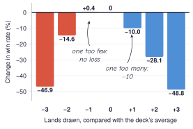
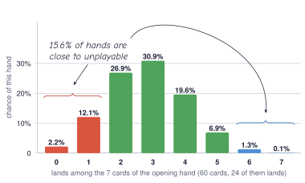
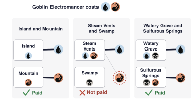
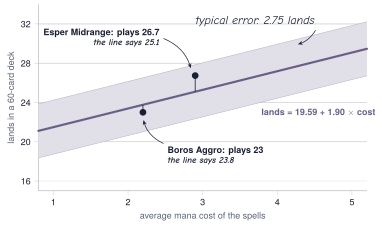
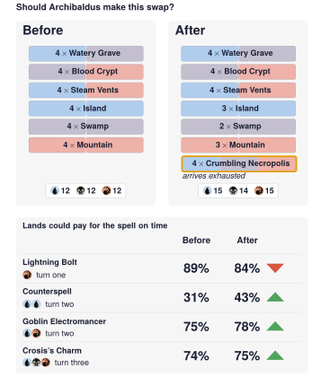

<!-- ## Three line summary

<!-- - In a wizard's duel (a game of *Magic: The Gathering*) you can only cast your spells if you draw the right *lands*, in the right colours, at the right time. Which lands to put in your spellbook is a probability problem.

<!-- - The classical answers count cards. The hypergeometric distribution tells you how likely you are to draw enough lands of one colour. Frank Karsten's tables, which he computes by simulating draws because the formula cannot handle mulligans, turn that into “play $14$ sources for this spell”, and a regression on $95{,}143$ tournament decks tells you how many lands to play in total.

<!-- - Counting stops working when lands interact with each other, with your spells and with your life total. That is where Part 2 begins.

<!-- ## Why should I care?

<!-- If you play Magic, because few things lose more games than your own lands, and the difference between a good and a bad set of lands is invisible until it is too late. If you don't, because it is a pleasant excuse to meet the hypergeometric distribution, conditional probability, Hall's marriage theorem and a linear regression, all of them doing honest work. No knowledge of the game is assumed. Everything we need is explained in the next section. -->

## Introduction

It's been two years since my last post. Finishing my PhD and starting my postdoc has kept me busier than expected. However, I feel it is time to fire the printing presses back up. After all, there is a pleasure in writing one's thoughts freely, and what else is one to do on a rainy Lancastrian night.

Our topic today is different to those we have touched on before. We will temporarily abandon pure mathematics (don't worry, we'll be back) for a much more practical application. Namely, we will assume that we are renowned wizards (as I said, it's practical), duelling for magical supremacy against rival spell-casters. Now, as everyone knows, wizards are very particular about their duels, which follow well defined rules. If you already know how to play Magic, feel free to skip to @sec-solutions.

1. Each wizard prepares in advance a spellbook (also called a *deck*) of at least $60$ cards (the wizarding committee is very strict about this). Spells may damage the opponent, draw more spells, summon magical creatures, or do a whole host of other things that help a wizard gain the upper hand.

2. Each wizard begins the duel holding $7$ cards from their spellbook, selected at random by the onlookers.

3. A coin is flipped to decide which wizard goes first (yes, even wizards haven't found a better way to do this).

4. The first wizard casts the spells they wish and then passes the turn. Their opponent draws one more card from their book (and so holds $8$), casts their own spells, and passes back.

5. The wizards continue in this fashion, drawing one card and casting what they can each turn, until one of them is defeated. The other is declared the victor.

### Mana

As anyone who has attended wizarding school knows, casting spells is a tricky business. To cast a spell a wizard needs enough raw magical power, called *mana*. There are five types of mana, one for each school of magic: light , water , dark , fire  and earth . The cost of a spell is printed in its corner. Here are three from the spellbook of Archibaldus the Grey, believed by many to be the most powerful wizard in the land. Text has been simplified to be easier to read by those not schooled in the wizardly arts.

::: {#fig-spells}



Three spells from the book of Archibaldus. The cost is in the top corner.
:::

So Lightning Bolt needs one fire mana, the Electromancer needs one water *and* one fire mana, and the Charm needs water, dark and fire all at once. Some spells also ask for mana of any type, written as a number: a cost of  means two water mana and one more of any type.

A wizard starts the duel with no mana at all. To obtain their mana they must play a special kind of card called a *land*. (Players of Magic will know that a land is not, strictly, a spell. From here on a *card* is anything in the book, and a *spell* is a card that is not a land.) There are three rules.

- A wizard may play at most one land each turn.

- A land stays in play for the rest of the duel.

- Each turn, each land may be used once to produce one mana of its type. A Mountain gives , an Island , a Swamp , a Forest  and a Plains .

::: {#fig-basics}



The five basic lands. Each makes mana of one colour.
:::

So a wizard has one mana on the first turn, two on the second, three on the third, provided they keep drawing lands. Lands and spells sit in the same spellbook and are drawn from the same pile. Drawing the right lands at the right time is tricky business and is what the rest of the post is about.

### Archibaldus wins a practice bout

Let us watch a few turns of Archibaldus's practice bout this morning. To keep things simple there is no opponent, and we only show the cards that matter. Archibaldus begins with no lands or spells cast and only cards in his hand. Press *Next* to step through his first three turns.

::: {#fig-duel-lucky}



Archibaldus wins a practice bout. Press Next to step through his first three turns.
:::

Archibaldus has done everything right. His mana grew every turn and he cast a stronger spell each time. In a real duel his opponent would be in serious trouble. A critical eye, however, might say he was a little lucky. Here is the same hand with different draws.

::: {#fig-duel-unlucky}



The same opening hand with different draws.
:::

This is known in the wizarding community as being *mana-locked* (the more common term is not fit for print). Related problems are drawing too few lands of any kind, and drawing exclusively lands, leaving the wizard with nothing to cast. All three are frustrating, and all three happen to the most powerful and esteemed wizards. Imagine the disgrace if Archibaldus lost to a novice because he drew the wrong lands and stood there unable to cast a thing. This is a problem, and a very important one. Archibaldus has entrusted us with solving it, or at least with making it as rare as we can.

## Common solutions {#sec-solutions}
To address the problem we must first look at the solutions the most powerful wizards already use.

### Non-basic lands

The five lands above are called *basic lands*. There are also more versatile lands, known as *non-basic lands*, that can produce more than one type of mana.

::: {#fig-nonbasic}



Four non-basic lands and what each one costs you.
:::

Had Archibaldus drawn a land that produces water or dark mana in place of his first Swamp, he would have cast the rest of his hand without trouble. So why not play only these? Because each comes with a price. Some enter play exhausted, so the wizard waits a turn before using them. Some cost life (a wizard begins with $20$ and loses at zero). And they are no guarantee: had he drawn a land that produces dark or fire mana, he would have been as stuck as before with no water mana to cast his spells. Non-basic lands help but they are not a panacea.

### Non-land mana sources & card draw

Lands are the main source of a wizard's mana, however there are other ones: powerful creatures, artifacts, rituals and spells that produce mana or allow them to play more lands. These are vulnerable to being countered by the rival wizard, and cost mana themselves, but increase the likelihood that the wizard maintains enough mana throughout the duel.

::: {#fig-other-sources}



A creature, an artifact and a ritual that produce mana.
:::

Additionally the savvy wizard will use spells that draw them cards or otherwise manipulate their spellbook, allowing them to more frequently draw the amount of mana sources they need.

::: {#fig-card-draw}



Three spells that draw cards. The last also lets the wizard play one more land.
:::

### Going mono-colour
Some wizards specialise in a single school of magic and play, say, only earth spells. They are never short of the right colour. Unfortunately, they also give up some of the most powerful spells, which tend to be the ones that combine schools.

::: {#fig-one-vs-two}



Two creatures with the same total cost.
:::

Moreover, even a mono-colour wizard must decide *how many* lands to play.

### Altering the land count {#sec-land-count}
Of course it is always possible to simply fill their spellbook with more lands. However, use too many and there will be no spells left to cast. Playing too few of course has the opposite problem of having no mana to play their spells.

It is worth asking how much is at stake. Fortunately, wizards keep records. The site 17Lands publishes the full history of millions of real games, including how many lands each player saw [@seventeenlandsdata]. We took $1{,}057{,}242$ of them (duels of the $40$-card format called “Limited”) and asked a simple question: among the first $13$ cards a player saw, how many were lands, compared with what their deck would give on average? And how often did they win?

{#fig-land-price fig-align="center" width="70%"}

The comparison is made within each deck, so that a strong deck does not distort it. Two points are important. The stakes are large: a couple of lands is the difference between a favourite and an underdog. And the curve is lopsided: in these duels, too many lands is worse than too few. One land fewer than expected costs nothing. One land more costs $10$ points of win rate. We will meet this lopsidedness again in Part 2 (yes, a follow-up is planned), where it turns out to matter a great deal.

As we can see many problems remain, mainly related to which lands to play and how many. If we wish to solve Archibaldus's problem we must turn to the most powerful magic of all. Mathematics.

## Exact calculation {#sec-exact}
If a book contains only basic lands, the chance of drawing the lands we need can be calculated exactly by counting the hands that contain the lands we need, and dividing by the number of all possible hands.

::: {.callout-note collapse="true" title="The formula: the hypergeometric distribution"}

Suppose a spellbook has $N$ cards of which $K$ are “good” (for instance, lands that produce fire mana). We look at $n$ cards from a well shuffled book. How many good ones do we see? This is determined by the hypergeometric distribution.

::: {#def-hypergeometric}

Let $X$ be the number of good cards among $n$ cards drawn without replacement from $N$ cards of which $K$ are good. Then $X$ follows the *hypergeometric distribution*,

$$
\mathbb{P}(X=k)=\frac{\binom{K}{k}\binom{N-K}{n-k}}{\binom{N}{n}}, \qquad \max(0,n-N+K)\le k\le \min(n,K).
$$ {#eq-hypergeometric}

:::

The formula is a count. There are $\binom{N}{n}$ equally likely sets of $n$ cards. To have exactly $k$ good ones we choose them in $\binom{K}{k}$ ways and choose the other $n-k$ cards from the $N-K$ bad ones. The case we need most is “at least one”, which is easiest through its complement:
$$
\mathbb{P}(X\ge 1)=1-\frac{\binom{N-K}{n}}{\binom{N}{n}}.
$$ {#eq-at-least-one}

:::

::: {#exm-opening name="The opening hand"}

A typical spellbook has $N=60$ cards and $K=24$ lands. The number of lands in an opening hand of $n=7$ is distributed as follows.

| Lands in hand | 0 | 1 | 2 | 3 | 4 | 5 | 6 | 7 |
|:--|:-:|:-:|:-:|:-:|:-:|:-:|:-:|:-:|
| Probability (%) | 2.2 | 12.1 | 26.9 | 30.9 | 19.6 | 6.9 | 1.3 | 0.1 |

:::

{#fig-opening-hand fig-align="center" width="75%"}

A hand with $0$, $1$, $6$ or $7$ lands is close to unplayable, and that happens $15.6\%$ of the time: roughly one duel in six starts badly before a single card is played.

::: {#exm-bolt name="Lightning Bolt on turn one"}

Archibaldus goes first and wants to cast  at once. He needs a fire land among his $7$ cards. By (@eq-at-least-one), if his $60$-card deck contains $K$ fire lands,

| Fire lands $K$ | 8 | 10 | 12 | 14 | 16 | 18 | 20 |
|:--|:-:|:-:|:-:|:-:|:-:|:-:|:-:|
| % success | 65.4 | 74.1 | 80.9 | 86.1 | 90.1 | 93.0 | 95.2 |

To be $90\%$ sure he needs $16$ of his $24$ lands to produce fire. If we play only basics, that leaves $8$ for water and dark, with which the  and the  are in serious danger.

:::

Thus we have learned something important.

::: {.callout-tip icon=false title="Lesson the first"}
To effectively play a deck with multiple colours, Archibaldus must play non-basic lands.
:::

Unfortunately for Archibaldus, this complicates matters greatly.

### Paying a cost is a matching problem {#sec-matching}

A land produces only one mana a turn.^[This holds in almost every circumstance, so we make this assumption to simplify the discussion. Hopefully the Tron and Titan wizards will forgive me.] Thus, to pay for a spell, each land must be matched to a symbol of the spell's cost. @fig-matching shows three attempts to pay for the , which costs . A single land that makes both colours is not enough, even though it makes water and it makes fire, and the Swamp beside it does not help.

{#fig-matching fig-align="center" width="85%"}

::: {.callout-note collapse="true" title="The mathematics: when can a wizard pay?"}

A wizard has $m$ lands $\ell_1,\dots,\ell_m$ in play, and land $\ell_j$ can produce any one colour in a set $A_j\subseteq\{W,U,B,R,G\}$. A spell costs $p_c$ mana of colour $c$ and $g$ mana of “any type”. Write $\abs{p}:=\sum_c p_c$ for the number of coloured symbols. Paying the cost means assigning a different land to each symbol, such that the land assigned to a symbol of colour $c$ has $c\in A_j$. This is a matching problem for a [bipartite graph](https://en.wikipedia.org/wiki/Bipartite_graph), with the lands on one side and the symbols on the other, as in @fig-matching.

::: {#prp-hall name="When can a wizard pay?"}

The cost can be paid if and only if there are enough lands in total, $m\ge \abs{p}+g$, and for every group of colours $C\subseteq\{W,U,B,R,G\}$ the lands that make at least one colour of the group are at least as many as the symbols of the group:
$$
\#\{j : A_j\cap C\neq\emptyset\}\;\ge\;\sum_{c\in C}p_c .
$$ {#eq-hall}

:::

It is not enough to check the group of all five colours. That only says there are as many coloured lands as coloured symbols, and two Mountains do not pay for . Every group has to be checked.

::: {.proof}

Both conditions are clearly necessary. For sufficiency, number the coloured symbols of the cost $s_1,\dots,s_{\abs{p}}$ and let $L_i$ be the set of lands that can make the colour of $s_i$. To pay, we must choose one land from each $L_i$ and never the same land twice. [Hall's marriage theorem](https://en.wikipedia.org/wiki/Hall's_marriage_theorem) says when this can be done: if and only if, for every collection $S$ of symbols, the sets $L_i$ with $s_i\in S$ contain between them at least $\abs{S}$ lands. So the sets of the theorem are sets of lands, one for each symbol, and the “distinct elements” we select are the lands. Two symbols of the same colour give the same set twice, which the theorem allows.

It remains to pass from collections of symbols to groups of colours. Let $C$ be the colours that appear in $S$. The lands in $\bigcup_{s_i\in S}L_i$ are those that make at least one colour of $C$, so the left side of Hall's condition depends only on $C$. The right side, $\abs{S}$, is largest when $S$ contains every symbol with a colour in $C$, and then it equals $\sum_{c\in C}p_c$. So Hall's condition for every $S$ is the same as (@eq-hall) for every $C$. Once the coloured symbols have their lands, the generic mana can be paid by any $g$ of the remaining $m-\abs{p}$ lands, which is possible exactly when $m\ge \abs{p}+g$.

:::

For the Goblin Electromancer, condition (@eq-hall) reads: at least one land that makes water, at least one that makes fire, and at least *two* lands that make water or fire. The third condition is the one that fails in the middle panel of @fig-matching: there are two lands, but only one of them makes water or fire.

There are $2^5-1=31$ such inequalities, and each coloured land in the book belongs to one of the $31$ possible types $A_j$. The number of lands of each type among the cards seen follows a multivariate version of (@eq-hypergeometric), so the probability of being able to pay is a finite sum. If the book has $t$ kinds of land and we have seen $n$ cards, the sum runs over the number of lands of each kind among them, which is at most $\binom{n+t}{t}$ terms. For six kinds of land and the nine cards seen by turn three that is $\binom{15}{6}=5{,}005$.

The proposition is about lands that each make one mana. Lands that turn one mana into two of other colours, lands that make two mana, and creatures that make mana would require further analysis that is not worth it as this approach is already too complicated even without this thrown into the mix.

:::

So with lands like these the exact probability can still be written down, as a sum over every combination of lands we might have drawn. Nobody does. For a single spell on a single turn the sum already has thousands of terms, and it still ignores which land was played on which turn, lands that enter exhausted, lands that replace themselves with other lands, and every spell that draws a card. This is the point at which we reach for a computer.

## Approximate probabilistic calculation

A more practical solution is for the wizard to attempt to estimate the probability of drawing lands in the right amount and type to be able to cast their spells. This is the path of the scholar-wizards, perhaps the greatest of whom is Frank Karsten, a member of the wizarding Hall of Fame who also holds a PhD in probability and game theory. His two articles [@karsten2018sources; @karsten2022lands] are what most serious wizards consult.

### How many mana sources of each type?
Karsten's first step [@karsten2018sources] is to separate two ways of failing. To wit, if Archibaldus cannot cast a three-mana spell on turn three because he only has two lands, that is the fault of the *number* of lands. If he has three lands of the wrong colours, that is the fault of the *type* of lands. To judge the type alone, Karsten looks only at the games where he has enough lands and, so that one table can serve every book, considers the simpler problem of casting a spell that only costs a single type of mana. Say fire for concreteness. This avoids the matching problem of @sec-matching.

<!--<!-- This seemed to have no bearing on the rest so I commented it out to reduce cognitive overhea and unnecewssary notation For a spell that costs $M$ mana in total, of which $k$ symbols are of one colour, he asks for
<!-- $$
<!-- \mathbb{P}\bigl(\text{at least } k \text{ sources of the colour by turn } M \;\big|\; \text{at least } M \text{ lands by turn } M\bigr),
<!-- $$ {#eq-karsten}
<!-- for the wizard who goes first. The bar is read “given that”: we look only at the games in which he has at least $M$ lands by turn $M$, and ask in what fraction of those he also has the colours. To see what the conditioning does, return to @exm-bolt with $K=14$ fire lands and 24 lands of all types in the deck and $M=1$. The event “a fire land in hand” is contained in the event “a land in hand”, so
<!-- $$
<!-- \mathbb{P}(\text{fire land}\mid\text{land})=\frac{\mathbb{P}(\text{fire land})}{\mathbb{P}(\text{land})}=\frac{0.861}{0.978}=0.880 .
<!-- $$-->
Karsten then lets the wizard take a *mulligan*, that is, return an unplayable hand and draw a new one with one card fewer. His rule is to return any seven-card hand with $0$, $1$, $6$ or $7$ lands, which are the bad hands of @exm-opening. Mulligans cannot be folded into the exact calculations of @sec-exact. So he estimates the probability of the wizard drawing enough mana by simulating a great many opening hands and draws for a $60$-card book with $24$ lands. Finally, he fixes a target percentage for being able to cast one's spells, $90\%$ for one-mana spells and rising up to $95\%$ for six-mana spells. The smallest number of sources that reaches the level is his recommendation.

| Cost | Cast on turn | Sources needed (of 24 lands) |
|:--|:--|:-:|
|  | 1 | 14 |
|  | 2 | 13 |
|  | 3 | 11 |
|  | 2 | 20 |
|  | 3 | 18 |
|  | 3 | 23 |

: Result of Karsten's mana source calculations. {#tbl-karsten}

For example,  requires $14$ fire sources. The table is simple, fast and has rightly become the standard.

It is also, by design, a table about **one spell** and **one colour** at a time, in a book where **simple lands are the only source of mana** and there is no **card draw**. Everything else needs a rule of thumb. This includes adapting the table for spells with multiple colours, lands that enter exhausted, cost life, or fetch other lands, creatures that produce mana, spells that draw cards and allow you to manipulate your deck, and the list continues.

::: {.callout-tip icon=false title="Lesson the second"}
Only counting mana sources handles one spell and one colour at a time.
:::

Furthermore how should one choose the optimal percentage for casting a spell? Too high imposes excessive constraints and too low leaves spells that often cannot be played. The $90\%$ rule is again only a rule of thumb.

::: {#fig-hard-cards}



How to adapt for these cards?
:::

## How many lands?
@tbl-karsten assumes $24$ lands and the next step of Karsten's research was to address the problem of how many lands a wizard should play. To do so Karsten turned to the data [@karsten2022lands]. He collected $95{,}143$ tournament decks of $60$ cards that had won more matches than they lost, and fitted a [linear regression](https://en.wikipedia.org/wiki/Linear_regression) of the number of lands on three features of the deck:
$$
\text{lands}\;\approx\;19.59\;+\;1.90\,\bar m\;-\;0.28\,d\;+\;0.27\,c ,
$$ {#eq-regression}
where $\bar m$ is the average mana cost of the spells, $d$ is the number of cheap spells that draw cards or produce mana, and $c$ is $1$ if the deck uses a *companion* (an extra spell available from the start) and $0$ otherwise. A book whose spells cost $3$ on average gets $19.59+1.90\cdot 3\approx 25.3$ lands, and loses one land for every three or four cheap card-drawing spells.

{#fig-regression fig-align="center" width="75%"}

This is a description of what successful wizards do, and a very useful starting point. Its author reports the fit plainly: the model explains about $40\%$ of the variation ($R^2=0.395$), with a typical error of $2.75$ lands. However, recall from @fig-land-price what two or even three lands can cost.

## Is this enough?

Let us collect what the scholar-wizards have given Archibaldus before he turned to us. He knows how many lands to play, to within two or three. He knows how many sources each of his spells would like, though some unclear rules of thumb are needed. What he does not have in any case is the thing he asked for, *a list of lands*.

To see why, take his book: thirty-six spells of water, dark and fire, and $24$ lands. Twelve are two-colour lands that can be used at once for $2$ life, and twelve are basic lands, four of each kind. That makes twelve sources of each colour. The table asks for $14$ fire sources for  and $20$ water sources for , which costs two water mana, so he is short everywhere. At least the number of lands is right: his spells cost $2.33$ mana on average, so (@eq-regression) suggests $19.59+1.90\cdot 2.33\approx 24.0$ lands.

A merchant now offers him four copies of , a land that makes any of his three colours but arrives exhausted. Should he swap four of his basic lands for them? He would have $15$ water, $14$ dark and $15$ fire sources, which adheres much closer to @tbl-karsten. However, lands that arrive exhausted do not count on the first turn, which is bad for Lightning Bolt. And four is the most such lands Karsten advises. Each rule is reasonable in isolation but together they give no clear verdict.

{#fig-swap fig-align="center" width="75%"}

We analysed both sets of lands (how exactly is the subject of Part 2). After the swap he can pay for Lightning Bolt on the first turn in $84\%$ of duels, down from $89\%$, and for Counterspell on the second turn in $43\%$, up from $31\%$. The other spells hardly shift. Is that a good trade? It depends on how much a first-turn Bolt is worth compared with a second-turn Counterspell, and no count of sources can tell us that.

None of this is a criticism of @tbl-karsten, which has proved useful for many a wizard. But Archibaldus is not most wizards, and he has a duel to win. In Part 2 we will see if we can help Archibaldus and weigh in on whether he should make the swap.
