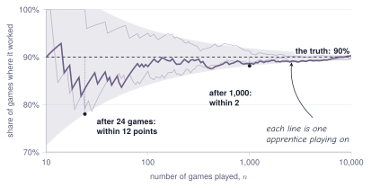
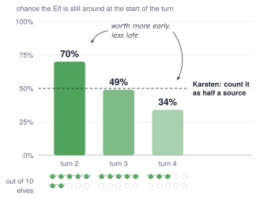
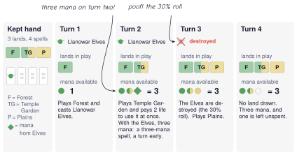
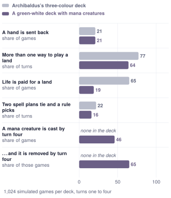
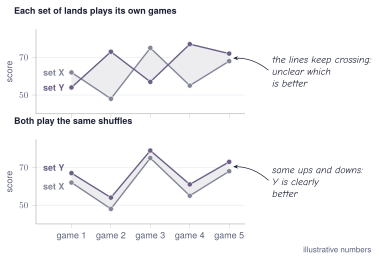
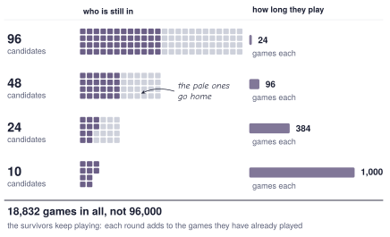
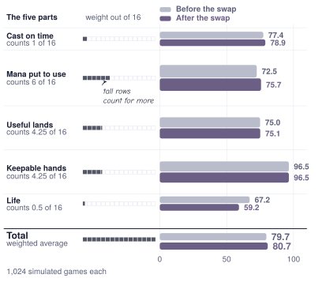
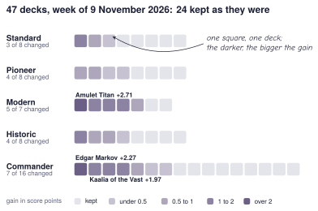

## Three line summary

- We address the problem of deciding on the best manabase for a given deck. Instead of limiting ourselves to counting mana sources, we simulate tens of thousands of practice duels and choose. This is Monte Carlo simulation.

- This requires rules of thumb that encode how a good wizard duels as well as a score learned from over $1{,}000{,}000$ real games.

- It is impossible to try every possible set of lands, so through iteration we choose a list of candidate manabases and have them compete in a tournament. The result is free to use at [manaoptimizer.com](https://manaoptimizer.com).

## Why should I care?

This post teaches Monte Carlo, a common solution to problems where exact calculation is impossible. Along the way we will need the law of large numbers, a trick for comparing two quantities fairly, and a healthy suspicion of our own results. And if you play Magic, because at the end there is a tool that helps you find the best manabase.

## Where we left off

In [Part 1](../lands-part-1/index.qmd) Archibaldus the Grey lost a practice bout with a hand full of spells and the wrong lands. We saw how scholar-wizards attack the problem by counting: the hypergeometric distribution, Frank Karsten's table of how many sources each spell wants [@karsten2018sources], and a regression for how many lands to play [@karsten2022lands]. We also saw where counting stops. Lands enter exhausted, cost life, and depend on each other. Spells draw cards and make mana. Every spell in the book wants something different, and there are only so many slots.

Archibaldus knows all of this. He did not ask for targets. He asked which lands to play. We left him with a question the tables could not settle: should he swap four basic lands for four lands that make all his colours but arrive exhausted?

## The apprentice

How often does a cauldron boil over? One could solve the equations of the fluid, the fire and the newt. Or one could boil a thousand cauldrons and count the ones that ruin the carpet. Apprentices are cheap.

This is the whole idea of *Monte Carlo simulation*. Let $A$ be an event whose probability $p=\mathbb{P}(A)$ we cannot compute, for instance “Archibaldus can pay for Crosis's Charm on turn three”. We play $n$ independent practice bouts and record the fraction in which $A$ happened,
$$
  \hat p_n=\frac1n\sum_{i=1}^n \mathbf{1}_A(\omega_i).
$$ {#eq-mc}
The law of large numbers says that $\hat p_n\to p$ as $n\to\infty$. How fast? Each term is a coin with bias $p$, so
$$
  \mathbb{E}[\hat p_n]=p,\qquad \operatorname{Var}(\hat p_n)=\frac{p(1-p)}{n},
$$
and by the central limit theorem $\hat p_n$ lies within $1.96\sqrt{p(1-p)/n}$ of $p$ about $95\%$ of the time. For $p=0.9$ this margin is $12$ percentage points after $24$ games, $1.9$ after $1{,}000$ and $0.19$ after $100{,}000$. To halve the error we must play four times as many games. Keep this in mind. It will decide most of what follows.

{#fig-estimate fig-align="center" width="92%"}

Nothing in (@eq-mc) cares how complicated the game is. Lands that enter exhausted, lands that cost life, spells that draw cards: the apprentice simply plays them. Other people have had this idea, of course. Karsten's own table, as we saw in Part 1, comes from simulation and not from a formula: his computer deals the cards and counts the lands, though nobody plays them. The site 17Lands offers a simulator for $40$-card decks [@conroy2023evaluator]. It deals the cards and records how many draws it takes before each spell could be cast, and it counts creatures and other cards that make mana as well as lands. It does not play the turns: there are no mulligans, no limit of one land a turn, no wait before a creature can make mana, and no spells that draw cards. Salubrious Snail's tool [@snailmanabase] does play the opening turns, with mulligans, lands that enter exhausted and cards that make mana, but without spells that draw cards. Both grade the lands you give them, and neither goes looking for better ones.

| | Karsten's table | 17Lands | Salubrious Snail | The apprentice |
|:--|:-:|:-:|:-:|:-:|
| Plays the turns | no | no | opening turns | yes |
| Mulligans | yes | no | yes | yes |
| Cards that make mana | rule of thumb | yes | yes | yes |
| Spells that draw cards | rule of thumb | no | no | yes |
| Looks for better lands | no | no | tries one more land | yes |

We want the last column: an apprentice who plays the turns as a wizard would, and a search that returns a list of lands.

## Teaching the apprentice to duel

Here is the catch. In [Part 1](../lands-part-1/index.qmd) we only had to count cards. Now somebody has to *play* them, and at every step there are choices. Which land this turn? Pay life to use it at once? Which spell first? We must write the answers down, for every situation, in advance. A complete set of such answers is called a *policy*. Ours is a list of rules of thumb, and it is the least glamorous and most important part of the whole enterprise.

- **The opening hand.** The apprentice may mulligan (return) a bad hand and draw seven new cards, putting one card on the bottom of the book for each time they have done so. Roughly, they keep a seven-card hand with two to five lands and at least two spells, become less picky after each mulligan, and choose the cards to keep so that as many of them as possible can be cast.

- **Which land.** Each turn the apprentice tries every land in hand, in every way it can be played. They choose the one after which the most spells can be paid for this turn; among those, the one that lets them spend the most mana; then the one that sets up the next turn best; and only then the one that costs the least life. So life is paid when it buys something, and not otherwise.

- **Which spells.** Spend as much mana as possible. Among equal plans, prefer spells that draw cards, then spells that make mana, then the most expensive spell.

- **Creatures that make mana.** These cannot be used on the turn they arrive. Worse, the opponent may destroy them. We have no opponent, so at the start of each later turn every such creature is removed with probability $0.3$. A creature summoned on turn one is therefore alive on turn two in $70\%$ of games, on turn three in $0.7^2=49\%$ and on turn four in $0.7^3\approx34\%$. (Karsten counts such a creature as half a source at all times.) This is the crudest rule on the list. A real opponent is most likely to destroy the creature in the first turn or two, when it matters most and there is little else to aim at, so a chance that falls from turn to turn would be closer to the truth. Ours is the same on every turn.

- **Who goes first.** Every shuffle is played twice, once going first and once going second.

{#fig-elf fig-align="center" width="60%"}

{#fig-one-game fig-align="center" width="92%"}

These are the main rules. There are others for rarer situations: when to trade in a land that fetches another and which land to fetch, which cards to keep when a spell lets us look at the top of the book, when to play a card that is both a spell and a land as a land, and how to use Treasures and other mana that can be spent only once. @fig-rules shows how often the main ones come into play. The rule for lands does the most work: in about three turns out of four Archibaldus has more than one way to play a land.

{#fig-rules fig-align="center" width="80%"}

Are these rules how a champion plays? No. A champion looks several turns ahead, holds mana back to answer the opponent, and knows which spell matters in which duel. But we are not trying to win the duel. We are trying to decide which of two sets of lands is better, and most of what the apprentice ignores would happen in the same way with either set, so it does not change which one comes out ahead. What we need is for the apprentice to use their lands as a sensible wizard would in the first four turns, since those are the turns in which lands decide games. Every rule can be read, and several can be changed: the $30\%$, for instance, can be set for each creature separately.

## Keeping score

The apprentice has played a thousand bouts with one set of lands. Now what? To compare two sets of lands we need a single number, and so we must decide what a good game is. This is the second thing counting never asked of us. The score has five parts, each between $0$ and $100$.

### Cast on time

Every spell is given a target turn, by default its total mana cost: a three-mana spell should be castable on turn three. For a spell $c$ with target turn $\tau_c$, let $D_c$ be the number of turns after $\tau_c$ at which the lands in play could first pay for it. The game earns credit
$$
  R_c=3^{-D_c}\ \text{ if } D_c\le 3,\qquad R_c=0\ \text{ otherwise,}
$$
that is $1$ if on time, $\tfrac13$ if one turn late, $\tfrac19$ if two, $\tfrac1{27}$ if three. The part is the average credit over games and over the spells of the book,
$$
  S_{\mathrm{cast}}=100\cdot\frac{\sum_c w_c\,\mathbb{E}[R_c]}{\sum_c w_c},
$$ {#eq-cast}
where $w_c$ is the number of copies of $c$ (times a value that is $0$ for a spell whose only effect is to replace itself with another card, and $1$ for almost everything else).

Two remarks. First, the question is whether the lands *could* pay for the spell, whether or not the spell is in hand that game. Drawing the spell is luck that has nothing to do with the lands, and leaving it out removes a great deal of noise. Second, compare with Karsten's formula from [Part 1](../lands-part-1/index.qmd). He conditions on having drawn enough lands, so as to judge the colours alone. We do not, so a game with too few lands counts against the lands, as it should when the number of lands is part of what we are choosing. As a result our numbers and his are not directly comparable, and ours will look lower.

### Mana put to use

A wizard who plays a land every turn has $1+2+\dots+T=T(T+1)/2$ mana over the first $T$ turns. The second part is the share of it that was spent on spells, with $T=4$ by default:
$$
  S_{\mathrm{mana}}=100\cdot\min\Bigl\{1,\ \frac{\text{mana spent on turns } 1,\dots,T}{T(T+1)/2}\Bigr\},
$$ {#eq-mana}
averaged over games (mana spent on a spell of value $0$ is left out). Lands that enter exhausted lower it directly. So does a missing colour.

### Useful lands

The third part looks at the lands the wizard saw in the first seven turns and asks what share of them were of any use. Let $\kappa$ be the cost of the dearest spells in the book (precisely, the $90$th percentile of the costs, and at least $2$). The $j$-th land seen is *useful* if $j\le\kappa$, or if at least $j$ mana was spent on the turn it was played or the turn after. So the first few lands are always useful, and a fifth land in a book of two-mana spells is useful only if those five mana actually went somewhere. Then
$$
  S_{\mathrm{use}}=100\cdot\frac{\text{useful lands seen, over all games}}{\text{lands seen, over all games}} .
$$ {#eq-use}
This is the part that punishes drawing nothing but lands. Its origin is the subject of the next section.

### Keepable hands and life

The fourth part is the average size of the hand the apprentice kept, as a share of seven: $S_{\mathrm{mull}}=100\cdot\mathbb{E}[\text{cards kept}]/7$. The fifth is $S_{\mathrm{life}}=100\cdot\max\{0,\,1-\ell/6\}$, where $\ell$ is the average life paid to the lands.

### The total

$$
  S=\frac{1\cdot S_{\mathrm{cast}}+6\cdot S_{\mathrm{mana}}+4.25\cdot S_{\mathrm{use}}+4.25\cdot S_{\mathrm{mull}}+0.5\cdot S_{\mathrm{life}}}{16}.
$$ {#eq-total}

We will see the five parts side by side, for two real sets of lands, in @fig-score-parts.

You should be suspicious of (@eq-total). Why $6$ and $4.25$? Why is casting spells on time, the very thing Part 1 was about, worth one sixteenth? I was suspicious too. The weights have a history, and it does not flatter the author.

## Where the weights come from

The first version of the score had four parts: cast on time, mana put to use, life and keepable hands, with weights $6$, $6$, $1$ and $3$. They were chosen by thinking hard. It ranked sets of lands sensibly. Then we asked it a different question: how *many* lands should a deck play?

We took eleven decks, nine of them from that week's tournament results, added and removed lands one at a time, let the search find the best lands for each count, and scored everything on $512$ fresh shuffles. For ten of the eleven decks the score preferred more lands than the deck played. On average it wanted one and a half more, and when we let it go further, for seven of the decks the best count was three or four more. No tournament wizard plays like that. The score had a blind spot, and it is easy to see where once you look. Extra lands make every spell easier to cast and every hand easier to keep. The only part that could object was mana put to use, measured over four turns, and the misery of drawing nothing but lands arrives on turn five.

So we went back to the real games of [Part 1](../lands-part-1/index.qmd). Recall the chart of win rate against lands seen: one land too many cost $10$ points, two cost $28$, while one too few cost nothing. That is a measurement of how real wizards are punished. We added the useful-lands part (@eq-use) so that the score could see a flood at all, and then chose the weights so that, when the apprentice plays the same kind of decks, the score falls off on either side in the same way the real win rate does. The weights on mana put to use and on useful lands come out of that fit. The weight on keepable hands is pinned down by a direct measurement: in the real games the first mulligan costs $15.5$ points of win rate. Together they come to $5.95$, $4.26$ and $4.28$ sixteenths, which we rounded to $6$, $4.25$ and $4.25$.

{#fig-fit fig-align="center" width="92%"}

Two weights could not be fitted. The data record how many lands a player saw, and not whether they were of the right colour or what they cost in life, so they say nothing about how much either one costs. For those we chose small values by hand, $1$ and $0.5$, which are enough to stop the search from giving a colour away or paying life for nothing. A small weight does not mean colours hardly matter: a missing colour also shows up, heavily, as mana that could not be spent.

The fit can be checked on a fact it was not given. In those drafts, decks with $16$ lands won about a point more often than decks with $17$. The old score said $17$ was better. The new one says $16$.

I find this the most satisfying part of the project and also the part to be most careful about. The data are $40$-card decks, and the score is not a probability of winning.

## So many lands

We can now score a set of lands. Which sets should we score? For a book with $24$ lands, suppose there are $b$ basic lands, of which any number may be played, and $q$ non-basic lands, of which at most four copies each. The number of possible sets is the number of solutions of
$$
  x_1+\dots+x_b+y_1+\dots+y_q=24,\qquad x_i\ge0,\quad 0\le y_j\le4 .
$$
For two colours with $b=2$ and $q=6$ this is $203{,}125$. For three colours with $b=3$ and $q=15$ it is $49{,}052{,}695{,}850$. At a thousand games each and a few thousandths of a second per game, trying them all would take thousands of years. Archibaldus's duel is on Thursday.

### Search

So we search. We begin with the wizard's own lands and around a hundred candidates built from a quick estimate of which colours the book needs. After that we move by small steps: take the best set so far and swap one, two or four copies of one land for another. A small statistical model watches which kinds of swap have helped and proposes the next ones by sampling from its own uncertainty about what works, so that it neither ignores its experience nor trusts it too much.

The details, with an example, are in the box.

::: {.callout-note collapse="true" title="How the search proposes swaps, with an example"}

**What the model is.** Each set of lands is described by a few numbers: how many sources it has of each colour, how many of its lands can be used at once in the early turns, the squares of these, and how many lands it plays of each family (basic lands, two-colour lands that cost life, and so on). Write $x_c$ for these numbers for a set $c$, measured from a reference set (the one that has played the most games). Write $d_c$ for the average difference in score between $c$ and the reference on the shuffles both have played. The model is a straight-line fit with noise,
$$
  d_c=x_c^{\top}\beta+u_c+\varepsilon_c,\qquad \beta\sim N(0,I),\quad u_c\sim N(0,\tau^2),\quad \varepsilon_c\sim N(0,\sigma^2/n_c),
$$
where $n_c$ is the number of shuffles played, $\varepsilon_c$ is the luck of those shuffles and $u_c$ is whatever a straight line cannot explain about $c$. Everything is Gaussian, so after seeing the scores our belief about $\beta$ is again Gaussian, with
$$
  A=I+\sum_c w_c\,x_cx_c^{\top},\qquad \bar\beta=A^{-1}\sum_c w_c\,x_c\,d_c,\qquad w_c=\Bigl(\frac{\sigma^2}{n_c}+\tau^2\Bigr)^{-1},
$$
that is, $\beta\sim N(\bar\beta,A^{-1})$. A set that has played many games counts for more.

**How it proposes.** Take the best set so far and list its neighbours: every set obtained by swapping one, two or four copies of one kind of land for another. To choose the next set to try, draw one value $\tilde\beta$ from $N(\bar\beta,A^{-1})$ and take the untried neighbour that $\tilde\beta$ predicts to be best. Then draw a new $\tilde\beta$ and choose again, until the round is full. This is called *Thompson sampling*.

**Why not simply trust the best guess?** Suppose the sets tried so far suggest that each extra water source is worth $0.3$ points, but the model has seen only a dozen sets, so the truth could as well be $0.1$ or $0.5$. A search that trusted $0.3$ would try only swaps that add water, and would never learn whether it was wrong about fire. Drawing $\tilde\beta$ afresh each time means that a swap the model is sure about is chosen nearly every time, and a swap it is unsure about is chosen now and then, which is how it finds out.

**An example.** For Archibaldus's lands (after the swap of the next section) the search ran as follows. The first field had $96$ candidates. After $24$ games each, $37$ were kept. After $96$ games, $15$. After $384$ games, $7$, and those played $1{,}000$. The best of them had $48$ neighbours, of which $15$ had already been tried. From the other $33$ the model chose $23$, which entered a second knockout together with the leader: $24$ candidates, then $11$, then $4$, then $2$. None beat the leader by more than a quarter of a point, so the search stopped.

**Was this the best choice?** I can only report what was measured. Before this, the search tried every swap of a single land. On eight test decks the version described here played about $16\%$ fewer games and found lands that scored the same. When there are games to spare the tool also plays a batch of random sets of lands after the first knockout, so that the model sees examples far from where it started.

:::

### The same shuffles for everyone

Suppose two sets of lands score $X$ and $Y$ in a game. We want $\mathbb{E}[X-Y]$. If each plays its own random games then the variance of the difference of the averages is $(\sigma_X^2+\sigma_Y^2)/n$, and with a difference of half a point it is unclear which set is better. If instead both play the *same* shuffles, with the spells in the same positions in the book, then
$$
  \operatorname{Var}\bigl(\bar X_n-\bar Y_n\bigr)=\frac{\sigma_X^2+\sigma_Y^2-2\rho\,\sigma_X\sigma_Y}{n},
$$ {#eq-crn}
where $\rho$ is the correlation between the two scores on the same shuffle. Two similar sets of lands do well and badly on the same shuffles, so $\rho$ is close to one and most of the noise cancels. It costs nothing, and it lets us see small improvements that we would otherwise miss.

{#fig-same-shuffles fig-align="center" width="80%"}

### A knockout tournament

By the error estimate of the previous section, a thousand games are needed to tell good sets of lands apart, and we cannot afford a thousand games for every candidate. Most candidates, however, are plainly bad after two dozen. So the candidates play in rounds: everyone plays $24$ games, the better ones continue to $96$, then $384$, and at most ten reach $1{,}000$.

{#fig-knockout fig-align="center" width="85%"}

### An honest ending

There is a trap here that every statistician knows. If we pick the best of a hundred noisy scores, the winner is partly the best and partly the luckiest, and its score flatters it. So the winner and the wizard's original lands are played once more on fresh shuffles that took no part in the search. Writing $D_j$ for the difference of their scores on shuffle $j$, with mean $\bar D$ and sample standard deviation $s_D$ over $n$ shuffles, we report the range
$$
  \bar D\;\pm\;t\,\frac{s_D}{\sqrt n},
$$
where $t$ is the $97.5\%$ point of Student's distribution with $n-1$ degrees of freedom. For the hundreds of shuffles we play, $t=1.96$ to two decimals, the same number as in the first section. Those who prefer to think as Bayesians can read the range in their own way: starting from no prior opinion about the size of the difference, and treating the $D_j$ as roughly normal, it is the range in which the true difference lies with probability $95\%$. The numbers are the same. We only call the new lands better if the whole range lies above zero. If it does not, the answer is: *your lands are as good as anything we found*. And when several sets are within a quarter of a point of the best, we recommend the one with the fewest changes. Telling a wizard to keep their lands is a perfectly good result, and as we are about to see, a common one.

## What happens when we try it

### Archibaldus's book

At the end of [Part 1](../lands-part-1/index.qmd) a merchant offered Archibaldus four copies of a land that makes all three of his colours but arrives exhausted, in place of four of his basic lands. The table liked the extra sources, the rule about exhausted lands did not, and we were left without an answer. Here is what the apprentice made of the two sets of lands, over $1{,}024$ bouts each on the same shuffles.

{#fig-score-parts fig-align="center" width="92%"}

Before the swap his lands score $79.7$, and after it $80.7$. On the paired shuffles the difference is $1.1$ points, with a range from $0.3$ to $1.8$. So he should make the swap. His first-turn spells are castable a little less often and he pays about half a life more each game, but more of his mana gets spent, because he is short of a colour less often.

The same kind of swap is not always right. The green and white deck of the next section wants to cast a creature on the first turn. If we replace four of its basic lands with four two-colour lands that arrive exhausted, it has two more sources of each colour and its score is *lower* by $0.5$ points (range $0.1$ to $0.9$). None of its spells is castable on time more often than before.

We then let the search loose on Archibaldus's new lands, choosing among the seven kinds of land already in his book. It came back proposing to turn one Swamp into a Mountain, for a difference of $-0.2$ points with a range from $-0.5$ to $+0.1$. In other words, nothing. The report says to keep the lands.

### Do we agree with Karsten?

Karsten's article [@karsten2018sources] ends with worked examples. They are a good test: where his assumptions hold (one spell of one colour, to be cast on a given turn, in a deck that has drawn enough lands) the apprentice ought to give the same answer. Where they do not hold, we should expect to differ. His lists are lands without spells, so we filled in nine spells for each from the cards he mentions.

| His example | His verdict | The apprentice |
|:-------------------|:----------------|:----------------------|
| Green and white, with one-mana green creatures. $8$ two-colour lands and $16$ basics. | Play $10$ Forest and $6$ Plains, not $8$ and $8$. | $10$ and $6$ is better by $0.37$ points (range $0.07$ to $0.68$). $6$ and $10$ is worse by $0.93$. |
| Water and dark, with a one-mana water spell and a three-mana spell needing two dark. | $9$ Island and $7$ Swamp, and it is a stretch. | $9$ and $7$, $8$ and $8$, and $7$ and $9$ cannot be told apart. $10$ and $6$ is worse by $0.40$ (range $0.14$ to $0.67$). |

So we agree where we should. The first row hides a nicer agreement still. With $8$ Forests the green-white deck has $12$ lands that give earth mana on the first turn, and with $10$ Forests it has $14$. Karsten's table says $12$ such lands cast a one-mana spell on turn one $86\%$ of the time, and that $14$ are needed to reach $90\%$. The apprentice, who has never seen the table, could pay for Llanowar Elves on turn one in $88\%$ of games with $12$ and $93\%$ with $14$. (Ours are a little higher because half of our games are played going second, with one more card.) Two methods that share nothing but the rules of the game land within a few points of each other.

The apprentice also shows what the extra Forests cost, which the table leaves to judgement: the five-mana Lyra Dawnbringer, who needs two light mana, is castable on time in $58\%$ of games, down from $60\%$.

::: {.callout-note collapse="true" title="The decks behind these numbers"}
Spells used. Green-white: Llanowar Elves, Pelt Collector, Emmara, Thrashing Brontodon, Knight of Autumn, Nullhide Ferox, Vivien Reid, Lyra Dawnbringer, Shalai. Blue-black: Thoughtbound Phantasm, Thought Erasure, Lazav, Blood Operative, Sinister Sabotage, Vraska's Contempt, Doom Whisperer, Nightveil Predator, Dream Eater. Only the Elves have an effect modelled; the rest count for their cost. Archibaldus's nine: Lightning Bolt, Thoughtseize, Goblin Electromancer, Counterspell, Terminate, Crosis's Charm, Kolaghan's Command, Electrolyze, Nicol Bolas the Ravager. 512 shuffles, each played first and second.

Lands. Archibaldus before the swap: four each of Watery Grave, Blood Crypt, Steam Vents, Island, Swamp and Mountain. After it, four Crumbling Necropolis replace one Island, two Swamps and one Mountain. The green and white swap starts from Karsten's list with $10$ Forests and $6$ Plains and puts four Selesnya Guildgates in place of two Forests and two Plains.
:::

### The top decks

Every week the apprentice is given the most played decks of each format. In the week of $9$ November $2026$ that was $47$ decks. For $24$ of them the recommendation was to change nothing. For the other $23$ the search found something it scored higher, by $0.7$ points in the median and $2.7$ at most. These gains are measured on the search's own games, so they flatter it a little, for the reason given in the previous section.

{#fig-top-decks fig-align="center" width="85%"}

I take this as good news twice over. Tournament wizards, as a community, are very good at lands, which is reassuring about them. And the apprentice mostly agrees with them, which is reassuring about the apprentice.

## What the apprentice gets wrong

It would be a poor show to spend a post on the limits of other methods and stay quiet about our own.

- **Costs that depend on the game.** A card is read for the cost printed on it, or for a cost you give it. If the real cost depends on what has happened in the duel, as with a spell that costs less for each card in the graveyard, the apprentice does not know.

- **Mana spent later is invisible.** Abilities that soak up spare mana in the late game are not credited, so the score can undersell lands in a deck built around them.

- **Every spell matters equally.** You can tell the apprentice on which turn you want a spell and what it really costs. You cannot yet tell it that one spell matters more than another: two copies count twice as much as one, and that is all.

- **The opponent, where it changes the answer.** Most of what an opponent does is the same whatever our lands are, and so does not affect which lands are better. Three things do. A point of life is worth more against a fast deck than a slow one, and we use one fixed weight. A creature that makes mana is destroyed with the same $30\%$ chance on every turn. And cards that punish non-basic lands are not there at all.

- **The weights were fitted to $40$-card games.** We checked them on eight tournament decks of $60$ cards. The old score wanted two more lands than these decks play, on average. The fitted score is within one land for four of the eight, and for three it prefers two lands fewer.

- **The search does not try everything.** No search can. It reports the best of the sets it tried, and it only tries the kinds of land it was given to choose from.

Karsten's tables have a virtue we should not lose sight of: you can hold them in your head. The apprentice asks you to trust rules you have not read. That is why every rule is written down, in a document that the code is obliged to follow, and why the tool will replay any single game for you, card by card, so that you can catch it playing badly.

## Try it

Archibaldus was willing to pay ungodly sums for this. For the good of the wizarding community we have instead put it online, free and with no account needed, at [manaoptimizer.com](https://manaoptimizer.com). Paste a decklist and it returns the lands, the five scores, and the swaps it would make with the reason for each. The code is open source [@manaoptimizer], and contributions and complaints from other wizards are very welcome, particularly complaints of the form “no sane wizard would play that land there”.

As for Archibaldus, he won on Thursday. He had drawn three Swamps by turn four. They were, this time, the right ones.
